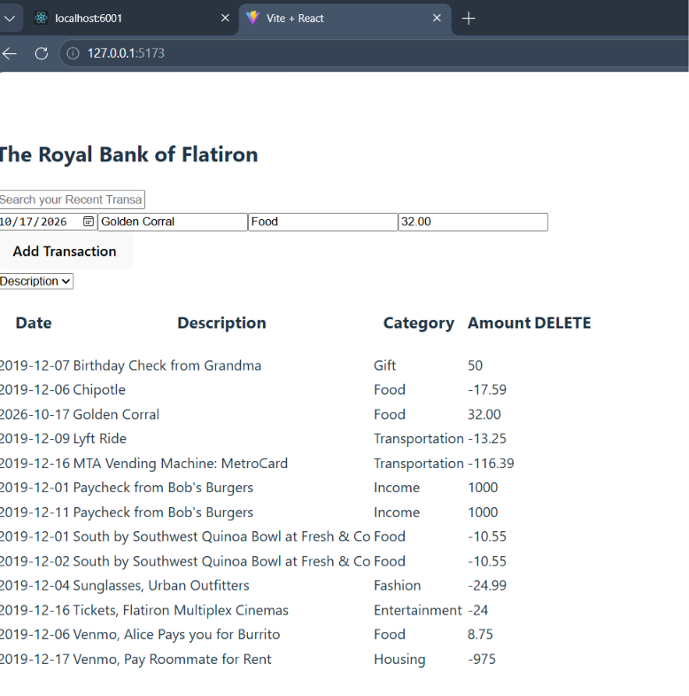

# Lab: Testing using Vitest

## Overview
Now that you have covered creating a testing suite, we can use the key principles of test-driven development to work with an existing app. Normally, you would build the testing while developing, but you were recently brought onto this project to add a testing suite! You are working to implement a testing suite for a banking application that allows users to track their expenditures by submitting and searching through them.

## Task 1: Define the Problem
- Build a testing suite for an existing application.

## Task 2: Determine the Design
- Identify the key features of this project.

## Task 3: Develop the Code
- One feature needs to be completed: the search functionality.

## Task 4: Test and Refine
- Build a test suite using Vitest to test key features:
  - Display transactions
  - Add transactions
  - Search transactions and sort transactions

## Task 5: Document and Maintain
- Commit as you go, writing meaningful commit messages.
- Push commit history to GitHub periodically and when the lab is complete.

## Tools and Resources
- Vitest: [Vitest Documentation](https://vitest.dev/guide/)

## Instructions

### Set Up
Before we begin coding, let's complete the initial setup for this lesson:

#### Fork and Clone
1. Go to the provided GitHub repository link.
2. Fork the repository to your GitHub account.
3. Clone the forked repository to your local machine.

#### Open and Run File
1. Open the project in VSCode.
2. Run `npm install` to install all necessary dependencies.

### Instructions
#### Task 1: Define the Problem
- Build a testing suite for an existing application.

#### Task 2: Determine the Design
- Identify the key features of this project.

#### Task 3: Develop, Test, and Refine the Code

1. Open the React application in the browser:
   ```sh
   npm run dev
   ```
2. Run the included backend:
   ```sh
   npm run server
   ```
3. Create a test branch.

#### Display Transactions Test
- Create a test suite that will test if transactions are displayed on startup.

#### Add Transactions Test
- Create a test suite that will test:
  - If new transactions are added to the frontend.
  - If a POST request was called.

#### Search Transactions and Sort Transactions Test
- Create a test suite that will test:
  - If a change event is triggered, the page updates accordingly.
  - Search is incomplete, so build out the search functionality based on the test.

4. Push the feature branch and open a PR on GitHub.
5. Merge to `main`.

### Task 4: Document and Maintain
#### Best Practice Documentation Steps:
- Add comments to the code to explain purpose and logic.
- Clarify intent/functionality of code for other developers.
- Add screenshots of completed work included in Markdown in `README.md`.
- Update `README.md` to reflect the functionality of the application following [Make a README](https://makeareadme.com).
- Delete any stale branches on GitHub.
- Remove unnecessary/commented-out code.
- If needed, update `.gitignore` to remove sensitive data.

### Submission
- Once the test suite is built, submit the link to the GitHub repository on Canvas.

### Grading Criteria
- The application has test suites.
- The application tests if transactions display on load.
- The application tests if a new transaction can be added.
- The application tests if search functionality updates the page correctly.

## Completed Application

This banking application lets users view, add, search, and sort transactions. Each transaction includes a date, description, category, and amount. Transactions are loaded from and saved to a local JSON Server backend.

### Features

- Display saved transactions when the application starts.
- Add transactions through a form and save them with a POST request.
- Search transaction descriptions regardless of capitalization.
- Restore the full transaction list when the search is cleared.
- Sort transactions alphabetically by description or category.

### Technologies

- React
- Vite
- JSON Server
- Vitest
- React Testing Library
- Testing Library User Event

### Running the Application

Install dependencies:

```bash
npm install
```

Start the backend:

```bash
npm run server
```

In a separate terminal, start the frontend:

```bash
npm run dev
```

Open the local URL displayed by Vite.

### Running Tests

Run all tests once:

```bash
npm test -- --run
```

Run tests in watch mode:

```bash
npm test
```

The test suites verify:

- Transaction details display on startup.
- Typing in Search calls the search handler.
- Searching filters the displayed transactions without case sensitivity.
- Changing the sort selection calls the sort handler.
- Transactions sort correctly by category and description.
- Submitting a transaction sends the correct POST request and displays the saved transaction.

Fetch requests are mocked during testing, so the tests do not require the backend to be running.

### Screenshot



### Development Approach

Search and sorting tests were written before implementing the missing functionality. The failing tests identified the missing behavior, and the application code was updated until the tests passed. Testing also identified a form-field access issue, which was corrected by accessing inputs through the form's elements collection.